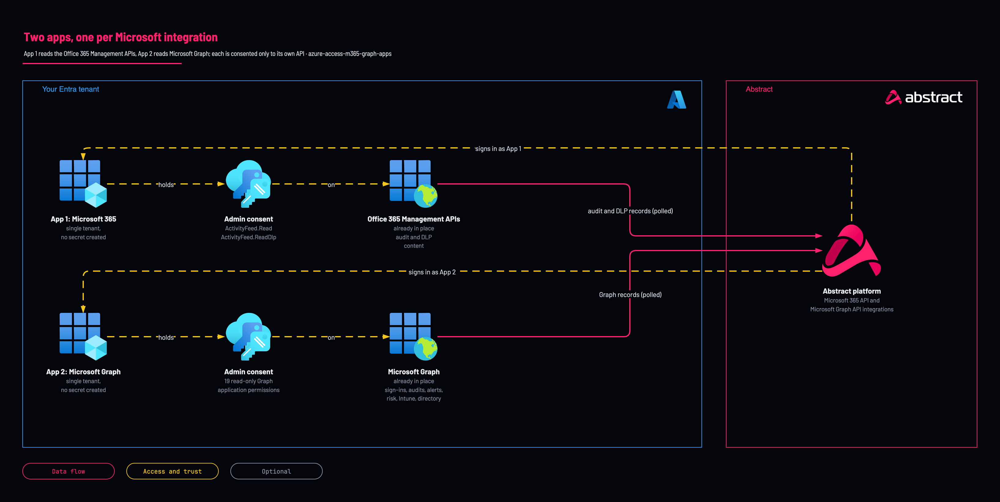

# Microsoft 365 and Graph apps

<!-- Generated from template.yml by `python -m tools.templates generate`. Do not edit. -->

<picture><source media="(prefers-color-scheme: dark)" srcset="https://raw.githubusercontent.com/IamABS3C/abstract-cloud-templates/main/docs/brand/abstract-logo-white.svg"></picture>

Creates the two Entra app registrations the Microsoft 365 API and Microsoft Graph API integrations sign in as, one app per integration, each consented only to its own API: App 1 holds the Office 365 Management APIs permissions ActivityFeed.Read and ActivityFeed.ReadDlp, and App 2 holds every Microsoft Graph application permission a Graph API 1.8.3 switch uses. Both apps are single tenant and tenant-wide; the resource group is only where the deployment runs. Uses the Microsoft Graph Bicep extension, so it deploys from Azure CLI or PowerShell. No client secret is created: add one to each app in the Entra admin center and type it straight into Abstract.

**Cloud:** azure · **Role:** access · **Scope:** resource-group



Editable source: [diagram.drawio](diagram.drawio)

## When to use

Every Microsoft 365 API and Microsoft Graph API onboarding. Always two apps, one per integration, each with its full permission list.

**Not for:** Event Hub collection (Activity Log, Entra ID diagnostic settings, Defender XDR streaming), which needs no app registration; use azure-foundation-event-hub. A per-subscription app for Event Hub access is azure-access-app-registration-logic-app.

Not sure this is the right one, or what to deploy before it? Answer a few questions in [the setup guide](https://github.com/IamABS3C/abstract-cloud-templates/blob/main/docs/azure/GUIDE.md).

## Deploy

From a shell, in this folder:

```bash
az group create -n RESOURCE_GROUP -l LOCATION   # skip if it exists
./deploy.sh RESOURCE_GROUP
./deploy.sh RESOURCE_GROUP --yes
```

`./deploy.sh RESOURCE_GROUP` previews the change with what-if and changes nothing; adding `--yes` deploys. Add `--parameters NAME=VALUE` after the scope to override a parameter.

## Prerequisites

- Azure CLI or Azure PowerShell with Bicep; there is no portal wizard for Microsoft Graph Bicep
- The bicepconfig.json that enables the Microsoft Graph extension, alongside main.bicep; az fetches the extension from mcr.microsoft.com
- For the Microsoft 365 API integration: unified audit logging on (Microsoft Purview portal &gt; Audit). A tenant where it was just turned on can take 24 to 48 hours to produce records
- what-if does not show Microsoft Graph resources, so the preview lists nothing; the outputs and the verify checks are the proof
- Removing a permission from graphPermissions on a redeploy takes it off the app's list but leaves its consent in place; remove that consent in Entra (Enterprise applications &gt; the app &gt; Permissions)
- Deleting the resource group does not delete the apps; delete them in Entra

## Cost

No Azure charge. The apps and consents are Entra objects.

## Parameters

| Name | Type | Required | Description | Find it |
|---|---|---|---|---|
| `m365AppDisplayName` | string | no | Display name of App 1, the app the Microsoft 365 API integration signs in as. |  |
| `m365AppUniqueName` | string | no | Tenant-wide unique key of App 1 (Microsoft Graph uniqueName). It makes a redeploy update the same app instead of creating another. Immutable once the app exists. |  |
| `graphAppDisplayName` | string | no | Display name of App 2, the app the Microsoft Graph API integration signs in as. |  |
| `graphAppUniqueName` | string | no | Tenant-wide unique key of App 2 (Microsoft Graph uniqueName). Immutable once the app exists. |  |
| `m365Permissions` | array | no | Office 365 Management APIs application permissions for App 1. ActivityFeed.Read delivers Audit.AzureActiveDirectory, Audit.Exchange, Audit.SharePoint and Audit.General; ActivityFeed.ReadDlp delivers DLP.All, which can include the detected sensitive values. |  |
| `graphPermissions` | array | no | Microsoft Graph application permissions for App 2. The default is every permission a Microsoft Graph API 1.8.3 switch uses. Leave one out only with the switch that needs it, since Abstract checks each switch that is on against the API when the integration is saved. |  |
| `grantAdminConsent` | bool | no | Grant tenant-wide admin consent to every permission (one app role assignment each). Needs a Privileged Role Administrator or Global Administrator deployer. Off: the apps are created with their permissions listed but not consented; an administrator consents later with the adminConsentUrls output. |  |

## Permissions

- **Privileged Role Administrator or Global Administrator (Entra directory role)** on The Entra tenant: Deployer: Grants tenant-wide admin consent to the application permissions (one app role assignment each on the Microsoft Graph and Office 365 Management APIs service principals). With grantAdminConsent false, the right to register an app (the default user setting, or Application Developer) is enough, and an administrator consents later.
- **Contributor (Microsoft.Resources/deployments/*)** on Any resource group: Deployer: Somewhere to run the deployment. Nothing is created in the group.
- **Office 365 Management APIs ActivityFeed.Read and ActivityFeed.ReadDlp (application permissions)** on App 1: Microsoft 365 API integration: Reads the Office 365 Management Activity API content types Audit.AzureActiveDirectory, Audit.Exchange, Audit.SharePoint, Audit.General and DLP.All.
- **19 Microsoft Graph application permissions, all read-only (graphPermissions)** on App 2: Microsoft Graph API integration: Each switch needs its own: AuditLog.Read.All for directory audits, sign-ins and provisioning; SecurityAlert.Read.All and SecurityIncident.Read.All for alerts and incidents; the rest for risk, health, secure score, Intune, Copilot, the Entra directory switches and the identity model.

## Creates

- App 1: an Entra app registration (default Abstract - Microsoft 365), single tenant, tagged abstract:microsoft-365-api, listing the Office 365 Management APIs permissions
- App 2: an Entra app registration (default Abstract - Microsoft Graph), single tenant, tagged abstract:microsoft-graph-api, listing the Microsoft Graph permissions
- A service principal for each app
- With grantAdminConsent: one admin-consent app role assignment per permission (2 for App 1, 19 for App 2 by default)

## Never touches

- Any client secret or certificate; none is created, read or output
- Other app registrations and service principals, including apps you made by hand for the same integrations
- Delegated permissions and user consent settings
- Azure resources; the resource group stays empty
- Entra ID diagnostic settings, Microsoft 365 audit settings and every other tenant setting

## Outputs

- `tenantId`
- `m365ClientId`
- `graphClientId`
- `m365ServicePrincipalId`
- `graphServicePrincipalId`
- `grantedM365Permissions`
- `grantedGraphPermissions`
- `adminConsentUrls`
- `abstractOnboarding`

## Verify

| Check | Command | Healthy when |
|---|---|---|
| The outputs carry the tenant ID and both client IDs (from ./deploy.sh; or read them back later) | `az deployment group show -g <resource-group> -n azure-access-m365-graph-apps --query properties.outputs.abstractOnboarding.value` | microsoft_365_api and microsoft_graph_api each show tenantId and clientId, and say where the secret goes. No secret is present. |
| App 1 is consented to both Office 365 Management APIs permissions | `az rest --method get --url "https://graph.microsoft.com/v1.0/servicePrincipals/<m365ServicePrincipalId>/appRoleAssignments" --query "length(value)"` | 2, one per Office 365 Management APIs permission. |
| App 2 is consented to every Graph permission in graphPermissions | `az rest --method get --url "https://graph.microsoft.com/v1.0/servicePrincipals/<graphServicePrincipalId>/appRoleAssignments" --query "length(value)"` | 19 with the default list; otherwise the length of graphPermissions. |
| Both integrations save in Abstract |  | After a client secret is added to each app, the Microsoft 365 API and Microsoft Graph API integrations save without a permission error, and events arrive within one poll interval. |
