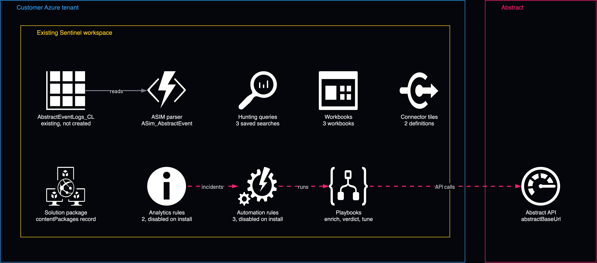

# Sentinel content for Abstract data: rules and workbooks

<!-- Generated from template.yml by `python -m tools.templates generate`. Do not edit. -->

<picture><source media="(prefers-color-scheme: dark)" srcset="https://raw.githubusercontent.com/IamABS3C/abstract-cloud-templates/main/docs/brand/abstract-logo-white.svg"></picture>

A self-contained approximation of the Abstract Microsoft Sentinel solution that installs connector tiles, an ASIM parser function, analytics and automation rules, hunting queries, workbooks and playbooks into an existing Sentinel workspace. Sufficient for a lab or private install; not a substitute for the certified Content Hub package.

**Cloud:** azure · **Role:** destination · **Scope:** resource-group



Editable source: [diagram.drawio](diagram.drawio)

## When to use

A lab or private install of the Abstract Sentinel content.

**Not for:** An official Content Hub or marketplace listing, which needs Microsoft's packaging and validation tooling run against the source.

Not sure this is the right one, or what to deploy before it? Answer a few questions in [the setup guide](https://github.com/IamABS3C/abstract-cloud-templates/blob/main/docs/azure/GUIDE.md).

## Deploy

[](https://portal.azure.com/#create/Microsoft.Template/uri/https%3A%2F%2Fraw.githubusercontent.com%2FIamABS3C%2Fabstract-cloud-templates%2Fmain%2Ftemplates%2Fazure%2Fazure-destination-sentinel-content-pack%2Fazuredeploy.json/createUIDefinitionUri/https%3A%2F%2Fraw.githubusercontent.com%2FIamABS3C%2Fabstract-cloud-templates%2Fmain%2Ftemplates%2Fazure%2Fazure-destination-sentinel-content-pack%2FcreateUiDefinition.json)

Or from a shell, in this folder:

```bash
az group create -n RESOURCE_GROUP -l LOCATION   # skip if it exists
./deploy.sh RESOURCE_GROUP
./deploy.sh RESOURCE_GROUP --yes
```

`./deploy.sh RESOURCE_GROUP` previews the change with what-if and changes nothing; adding `--yes` deploys. Add `--parameters NAME=VALUE` after the scope to override a parameter.

## Prerequisites

- An existing Log Analytics workspace with Microsoft Sentinel enabled, where the Abstract table AbstractEventLogs_CL lives
- The Abstract API key (abstractApiKey with keyVaultMode Create or Existing), or a Key Vault secret URI for it (keyVaultSecretUri)
- The Abstract API base URL and vendor account ID for the playbooks, or configure them later
- Review each rule and enable the ones you want; they install disabled
- Before the first deploy, someone with Owner or User Access Administrator on this resource group grants Microsoft Sentinel permission to run playbooks, then waits about 10 minutes for Azure to apply it (measured: a deploy one minute after the grant still failed): az role assignment create --assignee 98785600-1bb7-4fb9-b9fa-19afe2c8a360 --role "Microsoft Sentinel Automation Contributor" --scope /subscriptions/SUBSCRIPTION_ID/resourceGroups/RESOURCE_GROUP (98785600-... is the application ID of Azure Security Insights, the same in every tenant)

## Parameters

| Name | Type | Required | Description | Find it |
|---|---|---|---|---|
| `workspace` | string | yes | Log Analytics / Sentinel workspace name. | `az monitor log-analytics workspace list --query "[].{name:name,location:location,resourceGroup:resourceGroup}" -o table` |
| `workspaceLocation` | string | no | Region of the existing Sentinel workspace. Every content resource is created in it; it must match the workspace's region. |  |
| `customTableName` | string | no | Custom table the Abstract Sentinel Destination writes to. |  |
| `logoUrl` | string | no | Connector tile logo. Defaults to the embedded Abstract Security mark (self-contained data URI). |  |
| `abstractBaseUrl` | string | no | Abstract API base URL (used by the playbooks). |  |
| `abstractVendorAccountId` | string | no | Abstract vendor account id for the playbooks (x-as-vendor-account-id). Leave blank to configure later. |  |
| `keyVaultSecretUri` | string | no | Key Vault secret URI for the Abstract API key, with ?api-version, for example https://&lt;vault&gt;.vault.azure.net/secrets/abstract-api-key?api-version=7.4. Used only when keyVaultMode is None, the default: playbooks fetch it at runtime through their managed identity (grant each 'Key Vault Secrets User'). With keyVaultMode Create or Existing the template points the playbooks at the secret it stored. The key is never stored in the template. Leave empty to install the playbooks without it; they fail until it is set. |  |
| `lookbackHours` | int | no | Enrich-incident playbook lookback window (hours). |  |
| `keyVaultMode` | string | no | Where this deployment stores the Abstract API key the playbooks call Abstract with. None, the default, stores nothing: the playbooks read the secret keyVaultSecretUri names, and you grant their roles yourself. Create makes a Key Vault in this resource group, in its region, (RBAC authorization, soft delete with 7-day retention, purge protection on, public network access enabled, no network rules) and writes abstractApiKey into it. A rerun with Create applies those settings to the vault again, so a vault you locked down afterwards (firewall, private endpoint) is opened again: once the vault exists, rerun with Existing. Existing writes abstractApiKey into the vault keyVaultName names, which must be in this resource group and use RBAC authorization for the role grants to apply. With Create or Existing, keyVaultSecretUri is ignored. Find existing vaults: Azure portal &gt; Key vaults, filtered to this resource group. Default: None. Example: Create. |  |
| `abstractApiKey` | securestring | no | The Abstract API key, written as a Key Vault secret when keyVaultMode is Create or Existing, and required then. A secure parameter: it never appears in the deployment's inputs, outputs or history. A rerun with Create or Existing needs the key again and writes it as a new version of the secret. Find it: the API key Abstract issued for your tenant, or ask Abstract. Default: empty. |  |
| `keyVaultName` | string | no | Name of the Key Vault. Create: 3 to 24 letters, digits and hyphens, unique in Azure; empty generates abskvs-&lt;hash&gt; from this resource group and keyVaultNameSuffix. Existing: the exact name of a vault in this resource group. Used only when keyVaultMode is Create or Existing. Purge protection keeps a deleted vault's name reserved for its 7-day retention. Find it: Azure portal &gt; Key vaults &gt; Name. Default: empty. Example: abstract-sentinel-kv. |  |
| `keyVaultNameSuffix` | string | no | Text mixed into the generated Key Vault name (keyVaultMode Create with keyVaultName empty), so a redeploy gets a new name. Set it after you deleted the resource group or the vault: purge protection keeps the deleted vault, and its name, for 7 days, and the same generated name then fails with VaultAlreadyExists. Empty, the default, keeps the name earlier runs generated. Find deleted vaults: Azure portal &gt; Key vaults &gt; Manage deleted vaults. Default: empty. Example: 2. | `az keyvault list-deleted --query [].name -o tsv` |
| `keyVaultSecretName` | string | no | Name of the secret that holds the Abstract API key, 1 to 127 letters, digits and hyphens. Used only when keyVaultMode is Create or Existing; a secret of that name already in the vault gets a new version. Find it: Key vaults &gt; the vault &gt; Objects &gt; Secrets. Default: abstract-api-key. Example: abstract-api-key. |  |
| `grantPlaybookRoles` | bool | no | Grant each playbook's managed identity Key Vault Secrets User on the stored secret (the secret only, not the vault) and Microsoft Sentinel Responder on the workspace, the two roles the playbooks need to run. Applies only when this deployment stores the key (keyVaultMode Create or Existing); with keyVaultMode None nothing is granted. Needs Owner, or User Access Administrator, on this resource group. Find the grants: Key vaults &gt; the vault &gt; Objects &gt; Secrets &gt; the secret &gt; Access control (IAM), and the workspace &gt; Access control (IAM). It is the master switch: grantPlaybookResponder and grantPlaybookSecretsUser leave out one role each, for playbooks that already hold it. Default: true. Example: true. |  |
| `grantPlaybookResponder` | bool | no | With grantPlaybookRoles, grant Microsoft Sentinel Responder on the workspace to each playbook. Turn it off when the playbooks already hold that role from an assignment made outside this deployment: Azure refuses a second assignment of the same role to the same identity on the same scope (RoleAssignmentExists), which fails the deployment. It applies to all three playbooks, so if only some hold the role, grant it to the others yourself and turn this off. Find the grants: the workspace &gt; Access control (IAM) &gt; Role assignments. Default: true. Example: false. | `az role assignment list --scope <workspace-resource-id> --role "Microsoft Sentinel Responder" -o table` |
| `grantPlaybookSecretsUser` | bool | no | With grantPlaybookRoles, grant Key Vault Secrets User on the stored secret to each playbook. Turn it off when the playbooks already hold that role on the secret from an assignment made outside this deployment, which would otherwise fail with RoleAssignmentExists. It applies to all three playbooks, so if only some hold the role, grant it to the others yourself and turn this off. Find the grants: Key vaults &gt; the vault &gt; Objects &gt; Secrets &gt; the secret &gt; Access control (IAM). Default: true. Example: false. | `az role assignment list --scope <secret-resource-id> --role "Key Vault Secrets User" -o table` |

## Permissions

- **Contributor** on The Sentinel workspace's resource group: Deployer: Install the solution content, workbooks, playbooks and their API connections; Contributor includes Microsoft.Resources/deployments/*. With keyVaultMode None (the default) the template creates no role assignments, so the playbook identities' roles below are granted separately by someone with Owner or User Access Administrator; with keyVaultMode Create or Existing and grantPlaybookRoles, the deployer needs Owner or User Access Administrator too, because the template grants them.
- **Key Vault Secrets User** on The Key Vault secret holding the Abstract API key (the secret only, not the vault): Each playbook's managed identity: Playbooks fetch the key at runtime. Granted by the template when keyVaultMode stores the key and grantPlaybookRoles is on.
- **Microsoft Sentinel Responder** on The workspace: Each playbook's managed identity: Playbooks comment on and update incidents. Granted by the template when keyVaultMode stores the key and grantPlaybookRoles is on.
- **Microsoft Sentinel Automation Contributor** on The resource group that holds the playbooks (this one): Microsoft Sentinel (the Azure Security Insights service principal): Lets the two run-playbook automation rules call the playbooks; without it the deploy fails with "Missing required permissions for Microsoft Sentinel on the playbook resource". Granting it needs Owner or User Access Administrator.

## Creates

- The solution package record (contentPackages) with linked metadata
- Two data connector definitions (connector tiles)
- The ASim_AbstractEvent parser function (saved search)
- Three hunting queries: Abstract_RareProduct, Abstract_HighRiskIdentities, Abstract_DailyValueSummary
- Two scheduled analytics rules, installed disabled
- Three automation rules, installed disabled and scoped to this pack's two rules
- Two workbooks: Pipeline Overview and Value &amp; ROI
- Three playbooks as nested deployments: enrich, verdict and tune
- Only with keyVaultMode Create or Existing: a Key Vault (Create: RBAC authorization, soft delete, purge protection), the secret keyVaultSecretName holding abstractApiKey, and with grantPlaybookRoles a nested deployment granting each playbook Key Vault Secrets User on that secret and Microsoft Sentinel Responder on the workspace

## Never touches

- Your own analytics rules, automation rules, workbooks and playbooks; it only adds its own items
- Incident status; the Verdict playbook comments and can raise severity, never closes

## Outputs

- `abstractApiKeySecretUri`
