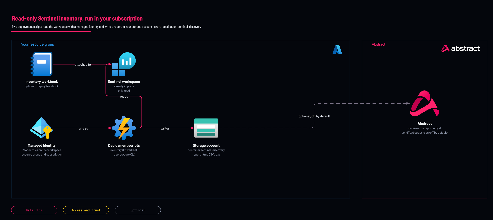

# Sentinel discovery: read-only inventory run from your own subscription

<!-- Generated from template.yml by `python -m tools.templates generate`. Do not edit. -->

<picture><source media="(prefers-color-scheme: dark)" srcset="https://raw.githubusercontent.com/IamABS3C/abstract-cloud-templates/main/docs/brand/abstract-logo-white.svg"></picture>

One Azure deployment that runs the read-only Sentinel inventory kit against one workspace from inside your subscription and writes the output to a storage account you own: a zip, one CSV per area, a self-contained HTML report and, optionally, the inventory workbook. Standalone, or as a module of the Sentinel solution (deployDiscovery).

**Cloud:** azure · **Role:** destination · **Scope:** resource-group



Editable source: [diagram.drawio](diagram.drawio)

## When to use

A customer who wants a read-only inventory of a Sentinel workspace, without installing anything or running a script on a workstation.

**Not for:** When an operator can run the kit by hand from a workstation; the discovery scripts in the Sentinel Discovery Kit do the same reads.

Not sure this is the right one, or what to deploy before it? Answer a few questions in [the setup guide](https://github.com/IamABS3C/abstract-cloud-templates/blob/main/docs/azure/GUIDE.md).

## Deploy

[](https://portal.azure.com/#create/Microsoft.Template/uri/https%3A%2F%2Fraw.githubusercontent.com%2FIamABS3C%2Fabstract-cloud-templates%2Fmain%2Ftemplates%2Fazure%2Fazure-destination-sentinel-discovery%2Fazuredeploy.json)

Or from a shell, in this folder:

```bash
az group create -n RESOURCE_GROUP -l LOCATION   # skip if it exists
./deploy.sh RESOURCE_GROUP
./deploy.sh RESOURCE_GROUP --yes
```

`./deploy.sh RESOURCE_GROUP` previews the change with what-if and changes nothing; adding `--yes` deploys. Add `--parameters NAME=VALUE` after the scope to override a parameter.

## Prerequisites

- A Log Analytics workspace with Microsoft Sentinel. A workspace created in the same deployment has nothing to read until its first complete day.

## Cost

Storage for the output, and two short container instances per run. Azure removes the containers when the scripts succeed. The inventory reads Azure Resource Manager and Log Analytics at no query charge on Analytics tables; Basic and Auxiliary tables are charged per GB scanned and only CommonSecurityLog and Syslog are read there, for deviceDays.

## Parameters

| Name | Type | Required | Description | Find it |
|---|---|---|---|---|
| `location` | string | no | Region for the resources this template creates. The workspace can be in any region. |  |
| `workspaceName` | string | yes | Name of the Log Analytics workspace that has Microsoft Sentinel. It is only read. |  |
| `workspaceResourceGroup` | string | no | Resource group of the workspace. Defaults to this resource group. |  |
| `workspaceSubscriptionId` | string | no | Subscription of the workspace. Defaults to this subscription. |  |
| `assignSubscriptionReader` | bool | no | Grant the identity Reader on the workspace subscription. The kit needs it to list data collection rules, endpoints, Sentinel workbooks and playbooks. Off: those areas are recorded as not read. |  |
| `storageAccountName` | string | no | Storage account for the output. Empty generates a name. Created with public blob access and shared-key access off. |  |
| `grantDeployerBlobRead` | bool | no | Give the person deploying this template Storage Blob Data Reader on the output container, so they can open the report. Shared keys are off, so the Owner role alone cannot read the blobs. |  |
| `days` | int | no | Look-back window in days for volume, health, agents and rules. |  |
| `deviceDays` | int | no | Window in days for the CEF and Syslog sender breakdowns. These scan the raw tables; leave at 1. |  |
| `profileTopTables` | int | no | How many of the largest Analytics-plan tables to break down by two columns. 0 turns it off. |  |
| `skipRuleQueryText` | bool | no | Leave the KQL text of analytics rules out of the output. The rule-to-table mapping is still produced. |  |
| `skipContentQueryText` | bool | no | Leave the KQL text of functions, hunting queries and saved searches out of the output. The content-to-table mapping is still produced. |  |
| `deployWorkbook` | bool | no | Install the Sentinel inventory workbook for this workspace. The workbook resource goes in this resource group. |  |
| `sendToAbstract` | bool | no | Send a copy to Abstract. OFF by default. When on, exactly two files leave your tenant, over HTTPS, to the SAS URL below: inventory.zip (the CSVs and summary.json: Azure resource names and IDs, table volumes, computer names and IP addresses from Heartbeat, device vendor and product names, and the KQL text of rules and functions unless you turned that off) and report.html (the same content as a report). No log records, watchlist items or credentials are in either file. With this off, nothing leaves your tenant. |  |
| `abstractSasUrl` | securestring | no | Only with sendToAbstract: the HTTPS SAS URL of the container Abstract gave you. It needs write permission on that container only. |  |
| `scriptRetention` | string | no | How long Azure keeps the deployment script resources and their logs after a run (ISO 8601). Azure allows 1 to 26 hours. The output in your storage account is not affected. |  |
| `rbacWaitMinutes` | int | no | Minutes to wait for the role assignments to take effect before failing the deployment. |  |
| `forceUpdateTag` | string | no | Change this value to run the discovery again. The default runs it on every deployment. |  |
| `tags` | object | no | Tags for the resources this template creates. |  |

## Permissions

- **Owner, or Contributor plus Role Based Access Control Administrator or User Access Administrator** on The deployment resource group, the workspace's resource group, and its subscription if assignSubscriptionReader is on: Deployer: create the resources and the role assignments for the discovery identity.
- **Reader, Microsoft Sentinel Reader, Log Analytics Reader** on The workspace's resource group: The discovery identity: read the workspace, its tables, rules and content.
- **Reader** on The workspace's subscription (assignSubscriptionReader): The discovery identity: list data collection rules, endpoints, workbooks and playbooks.
- **Storage Blob Data Contributor** on The output container only: The discovery identity: write the report and data files.

## Creates

- A user-assigned managed identity abstract-sentinel-discovery-&lt;id&gt;
- A storage account with public blob access and shared-key access off, and a container sentinel-discovery for the output
- Two deployment scripts (Azure PowerShell and Azure CLI) that run the inventory and build report.html; Azure adds a temporary storage account and container instance for each and removes them on success
- The workbook Sentinel inventory (&lt;workspace&gt;) attached to the workspace, when deployWorkbook is on

## Never touches

- Workspace settings, tables, data, retention, plans or the pricing tier
- Analytics rules, automation rules, hunting queries, incidents, watchlists, data connectors, functions or parsers
- Data collection rules, endpoints and agents
- Anything in Microsoft Entra ID, and any secret; key vault names are listed, never their contents

## Outputs

- `identityPrincipalId`
- `storageAccountName`
- `containerName`
- `runPrefix`
- `reportBlobUrl`
- `areasRead`
- `readErrors`
- `readsRefused`
- `pricesLive`
- `sentToAbstract`
- `listCostPerMonthNow`
- `workbookId`

## Verify

| Check | Command | Healthy when |
|---|---|---|
| The output reportBlobUrl names report.html in the container, and readErrors is 0 or the listed reads are explained by read_errors.csv | `az deployment group show -g RESOURCE_GROUP -n azure-destination-sentinel-discovery --query properties.outputs` |  |
