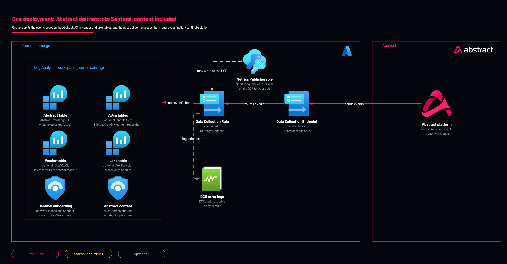

# Abstract Security for Microsoft Sentinel: one-deploy solution

<!-- Generated from template.yml by `python -m tools.templates generate`. Do not edit. -->

<picture><source media="(prefers-color-scheme: dark)" srcset="https://raw.githubusercontent.com/IamABS3C/abstract-cloud-templates/main/docs/brand/abstract-logo-white.svg"></picture>

One Azure deployment sets up everything Abstract needs to deliver data into Microsoft Sentinel, and the Abstract content that uses it. The data plane is the Azure Sentinel Destination template, reused as a module: a new or existing workspace with Microsoft Sentinel, a Data Collection Endpoint, the AbstractEventLogs_CL table, a Data Collection Rule with Monitoring Metrics Publisher for the Abstract app on that rule only, and DCR error logging. On the same rule it adds the routes you choose: Microsoft's ASim tables, a store-once option, a cheap Auxiliary lake table, and vendor-native tables filled with Microsoft's own connector transformation (Okta into OktaV2_CL). The Content hub package Abstract Security for Microsoft Sentinel is installed with it: a data connector tile, the ASim_AbstractEvent parser, two analytics rules (disabled), three hunting queries, five workbooks, three playbooks and their automation rules. Every content item has its own switch.

**Cloud:** azure · **Role:** destination · **Scope:** resource-group



Editable source: [diagram.drawio](diagram.drawio)

## When to use

A customer receiving Abstract data in Microsoft Sentinel who wants the Azure side and the Abstract content in one deployment.

**Not for:** When you only need the ingestion stack; use azure-destination-sentinel. When the Content hub package must come from the Marketplace instead; use azure-destination-sentinel-content-pack.

Not sure this is the right one, or what to deploy before it? Answer a few questions in [the setup guide](https://github.com/IamABS3C/abstract-cloud-templates/blob/main/docs/azure/GUIDE.md).

**Step by step, with a screenshot of every screen:** [the setup guide for this template](https://iamabs3c.github.io/abstract-cloud-templates/sentinel-guide/).

## Deploy

[](https://portal.azure.com/#create/Microsoft.Template/uri/https%3A%2F%2Fraw.githubusercontent.com%2FIamABS3C%2Fabstract-cloud-templates%2Fmain%2Ftemplates%2Fazure%2Fazure-destination-sentinel-solution%2Fazuredeploy.json/createUIDefinitionUri/https%3A%2F%2Fraw.githubusercontent.com%2FIamABS3C%2Fabstract-cloud-templates%2Fmain%2Ftemplates%2Fazure%2Fazure-destination-sentinel-solution%2FcreateUiDefinition.json)

Or from a shell, in this folder:

```bash
az group create -n RESOURCE_GROUP -l LOCATION   # skip if it exists
./deploy.sh RESOURCE_GROUP
./deploy.sh RESOURCE_GROUP --yes
```

`./deploy.sh RESOURCE_GROUP` previews the change with what-if and changes nothing; adding `--yes` deploys. Add `--parameters NAME=VALUE` after the scope to override a parameter.

## Prerequisites

- An Entra app registration for Abstract. Pass its service principal object ID (not the client ID) as principalId, and keep its client ID, client secret and tenant ID for the Abstract destination.
- For an existing workspace: it must be in this resource group and already run Microsoft Sentinel, and the Data Collection Endpoint and Rule are created in its region (existingWorkspaceLocation).
- Deploy in Incremental mode only. Complete mode would delete everything else in the resource group.
- A new workspace with enableAsim on can stop once with InvalidOutputTable: Microsoft Sentinel creates the ASim tables a minute or two after it is switched on. Deploy again with the same inputs (in the portal, open the failed deployment and select Redeploy). deploy.sh does this by itself: it waits 3 minutes and runs once more. A rerun changes nothing that already succeeded, and the rule keeps its immutable ID.
- Azure allows 20 dataflows per Data Collection Rule. This rule uses 1 catch-all, 1 per ASIM schema (up to 8), 1 for the lake and 1 per entry in nativeVendors, so 19 at most today. The template counts them before it changes anything and stops with "The Data Collection Rule would have N dataflows; Azure allows 20"; the output dataFlowCount reports the number deployed.
- With deployPlaybookAutomationRules: grant Microsoft Sentinel Automation Contributor on this resource group to Azure Security Insights (98785600-1bb7-4fb9-b9fa-19afe2c8a360, the same app in every tenant) about 10 minutes before, or the deployment fails with "Missing required permissions for Microsoft Sentinel on the playbook resource".

## Cost

Ingestion into AbstractEventLogs_CL is charged at its plan (Analytics by default). With enableAsim, each mapped event is a further copy in its ASim table unless excludeAsimFromAbstractTable is on; each vendor in nativeVendors adds a copy in that vendor's table. Lake rows are charged at the data lake rate. Retention beyond the free period, and Logic App runs of the playbooks, are charged. Data Collection Endpoint and Rule billing is not verified.

## Parameters

| Name | Type | Required | Description | Find it |
|---|---|---|---|---|
| `location` | string | no | Azure region of a new workspace, and of the Data Collection Endpoint and Rule. Change it only when the resource group's region is not where the data should live; every Abstract resource must sit in the workspace's region, and moving it later means a new workspace. Find it: Azure portal &gt; Resource groups &gt; your group &gt; Overview &gt; Location. Default: the resource group's region. Example: eastus. | `az group show -n <resource-group> --query location -o tsv` |
| `createWorkspace` | bool | no | true creates a Log Analytics workspace and switches Microsoft Sentinel on. Set false to use a workspace that already runs Sentinel in this resource group; nothing about that workspace (SKU, retention, daily cap, network) is changed. Find it: Azure portal &gt; Microsoft Sentinel lists every workspace that runs Sentinel, with its resource group. Default: true. Example: false. A new workspace is a new billable resource; pointing Abstract at a second workspace splits your data. | `az monitor log-analytics workspace list -g <resource-group> --query [].name -o tsv` |
| `workspaceName` | string | no | Name of the workspace. New workspace: leave empty to generate abstract-sentinel-&lt;hash&gt;, or give a name of 4 to 63 letters, digits and hyphens. Existing workspace: its exact name, which must be in this resource group, or the deployment fails. Find it: Azure portal &gt; Log Analytics workspaces &gt; Name. Default: empty. Example: sentinel-prod. | `az monitor log-analytics workspace list -g <resource-group> --query [].name -o tsv` |
| `workspaceRetentionDays` | int | no | Interactive retention of a new workspace, 7 to 730 days. Used only when createWorkspace is true; an existing workspace is never changed. Raise it when policy needs searchable data longer. Find the current value: Azure portal &gt; Log Analytics workspaces &gt; the workspace &gt; Usage and estimated costs &gt; Data retention. Default: 90. Example: 180. Microsoft Sentinel includes 90 days; each day above that is billed per GB retained. | `az monitor log-analytics workspace show -g <resource-group> -n <workspace> --query retentionInDays -o tsv` |
| `existingWorkspaceLocation` | string | no | Region of the existing workspace, when it differs from location. The Data Collection Endpoint and Rule must be in the workspace's region; a mismatch fails the deployment. Leave empty for a new workspace, or when the workspace is in location. Find it: Azure portal &gt; Log Analytics workspaces &gt; the workspace &gt; Overview &gt; Location. Default: empty. Example: eastus2. | `az monitor log-analytics workspace show -g <resource-group> -n <workspace> --query location -o tsv` |
| `tags` | object | no | Tags on every resource the template creates that supports tags. Set them when your policy requires tags such as owner or cost centre; Azure Policy can deny an untagged deployment. Find what is required: Azure portal &gt; Policy &gt; Assignments on this subscription. Default: none. Example: {"owner": "secops"}. | `Azure portal > Policy > Assignments, for any tag your subscription requires` |
| `principalId` | string | no | Object ID of the service principal Abstract signs in as. It gets Monitoring Metrics Publisher on the Data Collection Rule only, which is all the Logs Ingestion API needs. Find it: Microsoft Entra ID &gt; Enterprise applications &gt; the Abstract app &gt; Overview &gt; Object ID. Not the Application (client) ID, which fails with PrincipalNotFound or grants nothing. Default: empty, which skips the grant: Abstract then gets HTTP 403 until you grant the role yourself. Example: the object ID GUID shown on that page. | `az ad sp show --id <application-client-id> --query id -o tsv` |
| `dataCollectionEndpointName` | string | no | Name of the Data Collection Endpoint Abstract sends to. Change it when a resource of that name already exists in the resource group for something else: a same-named endpoint is updated in place. Find existing ones: Azure portal &gt; Monitor &gt; Data Collection Endpoints. Default: abstract-dce. Example: abstract-dce-prod. Its URL is the output dataCollectionEndpointUrl. | `az monitor data-collection endpoint list -g <resource-group> --query [].name -o tsv` |
| `dataCollectionRuleName` | string | no | Name of the Data Collection Rule. Keep the name across redeploys: the rule then keeps its immutable ID and Abstract keeps sending. A new name creates a second rule with a new ID, which the Abstract destination must then be changed to, and a same-named rule made for something else is replaced. Find existing ones: Azure portal &gt; Monitor &gt; Data Collection Rules. Default: abstract-dcr. Example: abstract-dcr-prod. | `az monitor data-collection rule list -g <resource-group> --query [].name -o tsv` |
| `customTablePlan` | string | no | Table plan of AbstractEventLogs_CL. Keep leaves an existing table's plan alone and creates a new table as Analytics, so a redeploy never changes cost by accident. Analytics runs analytics rules and this content; Basic is cheaper with limited queries; Auxiliary is the data lake tier, cheapest, with no analytics rules or alerts on it. A plan set here applies to the whole table. Find the current plan: Log Analytics workspaces &gt; the workspace &gt; Tables &gt; AbstractEventLogs_CL &gt; Plan. Default: Keep. Example: Analytics. | `az monitor log-analytics workspace table show -g <resource-group> --workspace-name <workspace> -n AbstractEventLogs_CL --query plan -o tsv` |
| `customTableRetentionDays` | int | no | Total retention of AbstractEventLogs_CL in days, 0 to 4383. 0 sends no retention: an existing table keeps its own, a new one takes the workspace's. Shortening it deletes data older than the new value; lengthening it bills each extra GB-day. Find the current value: Log Analytics workspaces &gt; the workspace &gt; Tables &gt; AbstractEventLogs_CL &gt; Total retention. Default: 0. Example: 365. | `az monitor log-analytics workspace table show -g <resource-group> --workspace-name <workspace> -n AbstractEventLogs_CL --query totalRetentionInDays -o tsv` |
| `enableDcrErrorLogs` | bool | no | Send the Data Collection Rule's ingestion errors (rejected requests, malformed rows, transformation and limit errors) to the DCRLogErrors table. Leave it on: the ingestion API answers 204 before it validates, so without it data Azure drops is invisible to you and to Abstract. Turn it off only if another diagnostic setting already collects these errors. Where it lands: Logs &gt; DCRLogErrors. Default: true. Example: true. Cost: only the error rows. | `Your choice. Azure portal > Monitor > Data Collection Rules > the rule > Diagnostic settings shows the current state` |
| `enableAsim` | bool | no | Also write each event into the Microsoft ASim table for its schema (ASimAuthenticationEventLogs, ASimNetworkSessionLogs and the others in asimSchemas), mapped from the Abstract Common Schema. Turn it on so Microsoft's ASIM analytics rules, hunting queries and workbooks see Abstract data. Expect new alerts, and duplicates where a Microsoft connector already collects the same vendor. Without excludeAsimFromAbstractTable each mapped event is stored and billed twice. Needs Microsoft Sentinel on the workspace. Find the tables: Logs &gt; Tables &gt; ASim*. Default: false. Example: true. | `Your choice. Azure portal > Microsoft Sentinel > Content hub lists the ASIM content you already run` |
| `asimSchemas` | array | no | ASIM schemas to write when enableAsim is on: ['*'] for all eight (AuditEvent, Authentication, Dns, FileEvent, NetworkSession, ProcessEvent, RegistryEvent, WebSession), or a list of names. Narrow it to bring ASIM in one schema at a time. Each schema is one dataflow of the 20 a rule allows. Default: ['*']. Example: ['Authentication', 'NetworkSession']. | `Your choice. Names: AuditEvent, Authentication, Dns, FileEvent, NetworkSession, ProcessEvent, RegistryEvent, WebSession` |
| `excludeAsimFromAbstractTable` | bool | no | Store once. With enableAsim on, an event an ASIM dataflow takes is not also written to AbstractEventLogs_CL, so it is stored and billed once, in its ASim table. Turn it on once your content reads the ASim tables; this solution's rules and parser already do. Content of your own that reads only AbstractEventLogs_CL stops seeing those events. Default: false. Example: true. | `Your choice. Azure portal > Microsoft Sentinel > Analytics: check that no rule of yours reads only AbstractEventLogs_CL` |
| `lakeTableName` | string | no | Name of a second custom table on the Auxiliary (data lake) plan, for events nothing in Sentinel needs to alert on. Set it with lakeCategories to cut cost: lake rows cost about 0.15 USD per GB at eastus list price against about 4.30 in the Analytics tier, but analytics rules, ASIM parsers and this content do not run on them, and the /query API returns no rows for them (use the /search API or a KQL job). Must end in _CL. Default: empty, lake route off. Example: AbstractLake_CL. | `Your choice: a new name ending in _CL` |
| `lakeCategories` | array | no | Abstract Common Schema event categories sent to the lake table instead of AbstractEventLogs_CL. An event matches when its event.category contains one of them. Events an ASIM dataflow takes never go to the lake. Find the categories in your data: in Abstract, the event.category field of the events you route. Default: empty, lake route off. Example: ['network', 'dns']. | `In Abstract: the event.category field of the events you route` |
| `lakeRetentionDays` | int | no | Total retention of the lake table in days, 30 to 4383. Used only when the lake route is on. Lake retention is billed per GB-month at the data lake rate. Default: 365. Example: 730. | `Your choice: your retention policy` |
| `nativeVendors` | array | no | Vendors and Microsoft tables the rule also writes to, one dataflow each of the 20 a rule allows, so Microsoft's own Content hub content works unchanged on Abstract-delivered data. Supported: okta (OktaV2_CL, created if missing), crowdstrike-hosts (CrowdStrikeHostsV2_CL, created if missing), csl-cef (CEF lines into CommonSecurityLog), csl-acs (Cisco ASA, Fortinet FortiGate and F5 ASM into CommonSecurityLog), syslog (Linux, Nutanix and Infoblox lines into Syslog), aws-cloudtrail (AWSCloudTrail), and the ASIM schemas asim-alert (Abstract findings into ASimAlertEventLogs), asim-dhcp (ASimDhcpEventLogs) and asim-user-management (ASimUserManagementActivityLogs). Use a vendor entry instead of, not as well as, Microsoft's own connector for that vendor, or every event arrives twice. When two entries select the same event it goes to one table only, the first in this order: asim-alert, okta, crowdstrike-hosts, aws-cloudtrail, csl-cef, csl-acs, syslog, asim-dhcp, asim-user-management. So Infoblox DHCP lines stay in Syslog, and CloudTrail and Okta user changes stay in AWSCloudTrail and OktaV2_CL. An unsupported name stops the deployment before any change. Default: none. Example: ['okta', 'csl-cef']. | `Azure portal > Microsoft Sentinel > Content hub, the vendor solutions you run. Supported: okta, csl-cef, csl-acs, syslog, aws-cloudtrail, crowdstrike-hosts, asim-alert, asim-dhcp and asim-user-management` |
| `oktaDomain` | string | no | Your Okta org domain, written to the DomainName column of OktaV2_CL as Microsoft's own Okta connector does. Used only with okta in nativeVendors. Microsoft's Okta content does not filter on it, so empty works, but the column is then empty. Quotes, spaces, backslashes, \| and ; stop the deployment. Find it: the address you sign in to Okta with, without https://. Default: empty. Example: example.okta.com. |  |
| `excludeNativeVendorsFromAsim` | bool | no | Stores each vendor event in one place. With a vendor in nativeVendors, an event that vendor's table takes is not also written to the ASim tables or the lake, and, with excludeAsimFromAbstractTable on, not to AbstractEventLogs_CL either. Without it the same Okta event lands in both ASimAuditEventLogs and OktaV2_CL and is billed twice. Turn it off only if you need that vendor in Microsoft's ASIM content as well as in the vendor's own solution. With it on, this solution's two analytics rules, the connector tile and ASim_AbstractEvent read that vendor's table, so they still see its events, but Microsoft's own ASIM rules and parsers do not. Find what a vendor lane takes: Logs, then query the vendor table, for example OktaV2_CL. Default: true. Example: true. | `Azure portal > Microsoft Sentinel > Content hub: confirm the vendor solution is installed` |
| `deployDataConnectors` | bool | no | Install the data connector tile Abstract Security (Security Data Pipeline). Its status counts Abstract rows in AbstractEventLogs_CL and the ASim tables. Turn it off only if you do not want the tile. Find it after deployment: Microsoft Sentinel &gt; Data connectors. Default: true. Example: true. No ingestion cost. | `Your choice. After deployment: Microsoft Sentinel > Data connectors` |
| `deployParsers` | bool | no | Install the workspace function ASim_AbstractEvent, which reads every Abstract event wherever the routes stored it and gives it ASIM column names. The hunting queries and the Pipeline Overview and Value &amp; ROI workbooks read it, so turning it off breaks them. Find it after deployment: Logs &gt; Functions &gt; ASim_AbstractEvent. Default: true. Example: true. | `Your choice. After deployment: Logs > Functions > ASim_AbstractEvent` |
| `deployAnalyticsRules` | bool | no | Install the analytics rules Abstract Security - Finding, Abstract Security - High or Critical event and Abstract - Repeated auth failures followed by success. Each is on or off as enabledAnalyticsRules says. They read the tables directly and call no workspace function. Find them: Microsoft Sentinel &gt; Analytics. Default: true. Example: true. | `Your choice. After deployment: Microsoft Sentinel > Analytics` |
| `enabledAnalyticsRules` | array | no | The analytics rules to turn on: finding (one incident per Abstract finding), high-or-critical (high or critical Abstract events) and repeated-auth-failures (failed sign-ins followed by a success). Every deployment sets each rule on or off from this list, so choose the rules here rather than in Microsoft Sentinel &gt; Analytics, or the next deployment turns them off. An enabled rule runs every hour and can create incidents. Default: none. Example: ['finding']. | `Microsoft Sentinel > Analytics, the Abstract rules and their Status. Supported: finding, high-or-critical, repeated-auth-failures` |
| `deployHuntingQueries` | bool | no | Install the hunting queries Rare or newly-seen product activity, High cumulative-risk identities and Daily value &amp; reduction summary. Find them: Microsoft Sentinel &gt; Hunting &gt; Queries. Default: true. Example: true. They run only when someone runs them. | `Your choice. After deployment: Microsoft Sentinel > Hunting > Queries` |
| `deployWorkbooks` | bool | no | Install the workbooks Pipeline Overview, Value &amp; ROI, Data Health and Cost by Table (the Sentinel Discovery workbook has its own switch). Find them: Microsoft Sentinel &gt; Workbooks &gt; My workbooks. Default: true. Example: true. They query only when opened. | `Your choice. After deployment: Microsoft Sentinel > Workbooks > My workbooks` |
| `deployDiscovery` | bool | no | Also run the Sentinel discovery inventory against this workspace (template azure-destination-sentinel-discovery as a module): a managed identity with read-only roles, a storage account for the report, and two short deployment scripts. Off by default because it adds roles and runs for 5 to 15 minutes. Find the output: the storage account in this resource group, container sentinel-discovery. Default: false. Example: false. |  |
| `deployDiscoveryWorkbook` | bool | no | Install the Sentinel Discovery workbook, which inventories the workspace (tables, connectors, rules, cost). Find it: Microsoft Sentinel &gt; Workbooks &gt; My workbooks. Default: true. Example: true. | `Your choice. After deployment: Microsoft Sentinel > Workbooks > My workbooks` |
| `deployAutomationRules` | bool | no | Install the automation rule Tag &amp; prioritize Abstract-originated incidents, which labels incidents from this solution's rules. It is on or off as enableAutomationRules says. Find it: Microsoft Sentinel &gt; Automation. Default: true. Example: true. | `Your choice. After deployment: Microsoft Sentinel > Automation` |
| `enableAutomationRules` | bool | no | Turn on the automation rules this deployment installs: Tag &amp; prioritize Abstract-originated incidents and, with deployPlaybookAutomationRules, Run ASTRO Verdict and Tune at source. Every deployment sets them on or off from this value, so set it here rather than in Microsoft Sentinel &gt; Automation, or the next deployment turns them off. Default: false. Example: true. | `Microsoft Sentinel > Automation, the Abstract rules and their Status` |
| `deployPlaybooks` | bool | no | Install the playbooks Abstract-Enrich-Incident, Abstract-Verdict and Abstract-Tune-At-Source (Logic Apps with a Sentinel API connection). They call the Abstract API with the key in keyVaultSecretUri. After deployment grant each playbook's managed identity Key Vault Secrets User on that secret and Microsoft Sentinel Responder on the workspace, or runs fail. Find them: Microsoft Sentinel &gt; Automation &gt; Active playbooks. Default: true. Example: true. Logic App runs are billed per action. | `Your choice. After deployment: Microsoft Sentinel > Automation > Active playbooks` |
| `deployPlaybookAutomationRules` | bool | no | Install the automation rules Run ASTRO Verdict and Tune at source, which run two of the playbooks (on or off as enableAutomationRules says). Needs deployPlaybooks, and Microsoft Sentinel Automation Contributor on this resource group granted to Azure Security Insights (app id 98785600-1bb7-4fb9-b9fa-19afe2c8a360) about 10 minutes before the deployment; without it the deployment fails with "Missing required permissions for Microsoft Sentinel on the playbook resource". Find the grant: Resource groups &gt; this group &gt; Access control (IAM) &gt; Role assignments. Default: false. Example: true. | `az role assignment list -g <resource-group> --role "Microsoft Sentinel Automation Contributor" -o table` |
| `abstractBaseUrl` | string | no | Abstract API base URL the playbooks call. Change it only for a non-production Abstract environment. Find it: the address of your Abstract API, as given by Abstract. Default: https://api.abstractsecurity.app. Example: https://api.abstractsecurity.app. | `The address of your Abstract API, as given by Abstract` |
| `abstractVendorAccountId` | string | no | Abstract vendor account ID the playbooks send as x-as-vendor-account-id, which selects your tenant in Abstract. Find it: in Abstract, your account settings, or ask Abstract. Default: empty, to set later in each playbook's parameters; until then the playbooks' Abstract calls fail. Example: AbCdEf1234. | `In Abstract: your account settings, or ask Abstract` |
| `keyVaultSecretUri` | string | no | URI of the Key Vault secret holding the Abstract API key. The playbooks read it at run time, so the key is never stored in the deployment or its history. Find it: Key vaults &gt; the vault &gt; Secrets &gt; the secret &gt; Secret Identifier. Default: empty, to set later; until then the playbooks' Abstract calls fail. Example: https://myvault.vault.azure.net/secrets/abstract-api-key. | `az keyvault secret show --vault-name <vault> -n <secret> --query id -o tsv` |
| `lookbackHours` | int | no | How many hours of Abstract data the Abstract-Enrich-Incident playbook reads around an incident. Raise it for slow-moving investigations; a longer window makes each run slower. Default: 24. Example: 72. | `Your choice: how far back an investigation should read` |

## Permissions

- **Owner, or Contributor plus User Access Administrator** on The resource group: Deployer: create the resources, and the one role assignment on the Data Collection Rule. Contributor alone is enough when principalId is empty.
- **Rights to register an app** on The Entra tenant: Deployer: create the Abstract app registration beforehand (azure-destination-sentinel/scripts/new-app-registration.sh does it).
- **Monitoring Metrics Publisher** on The Data Collection Rule only: Abstract runtime app: all the Logs Ingestion API needs. It cannot read data or change the rule. The deployment grants it when principalId is set.
- **Microsoft Sentinel Automation Contributor** on The resource group, for the Azure Security Insights service principal (app id 98785600-1bb7-4fb9-b9fa-19afe2c8a360): Only with deployPlaybookAutomationRules: lets Sentinel automation rules run the playbooks. Grant it about 10 minutes before the deployment; the template does not grant it.
- **Key Vault Secrets User and Microsoft Sentinel Responder** on The API-key secret, and the workspace: Each playbook's managed identity, only with deployPlaybooks: read the Abstract API key at run time and update incidents. Granted separately; the template creates no role assignment for the playbooks.

## Creates

- A Log Analytics workspace with Microsoft Sentinel, only when createWorkspace=true
- The custom table AbstractEventLogs_CL, with one column per top-level key of the Abstract Common Schema event
- A Data Collection Endpoint (default abstract-dce) and a Data Collection Rule (default abstract-dcr) whose input stream Custom-AbstractEventLogs_CL is the stream Abstract sends to
- Monitoring Metrics Publisher on the Data Collection Rule for principalId, when it is set
- A diagnostic setting sending the rule's ingestion errors to DCRLogErrors (enableDcrErrorLogs, on by default)
- Optional routes on the same rule: one ASIM dataflow per schema in asimSchemas (enableAsim), the lake table on the Auxiliary plan (lakeTableName and lakeCategories), and one vendor-native or ASIM dataflow per entry in nativeVendors (okta and crowdstrike-hosts create their table if missing)
- The Content hub package Abstract Security for Microsoft Sentinel (contentPackages, one contentTemplate per item, and metadata linking each installed item to the package)
- Behind its own switch each: the data connector tile, the ASim_AbstractEvent parser, the analytics rules High or Critical event, Repeated auth failures followed by success and Finding (all disabled), three hunting queries, the workbooks Pipeline Overview, Value &amp; ROI and Sentinel Discovery, the playbooks Abstract-Enrich-Incident, Abstract-Verdict and Abstract-Tune-At-Source with their Sentinel API connection, and the automation rules (disabled)

## Never touches

- Analytics rules, automation rules, hunting queries, workbooks, playbooks and parsers that are not this solution's
- The SKU, retention, daily cap, access mode, network settings or workspace transformation DCR of an existing workspace
- Any table other than AbstractEventLogs_CL, the lake table and the vendor tables it creates
- Any other Data Collection Rule, Data Collection Endpoint or diagnostic setting, unless it has the same name as one the template creates
- Microsoft's own data connectors and their Content hub solutions; install the Okta Single Sign-On solution yourself to get its parsers and rules over OktaV2_CL

## Outputs

- `workspaceName`
- `workspaceResourceId`
- `dataCollectionRuleImmutableId`
- `dataCollectionEndpointUrl`
- `logStreamName`
- `rbacAssigned`
- `dataFlowCount`
- `nativeVendorTables`
- `discoveryReportBlobUrl`
- `contentTemplateCount`
- `abstractDestination`

## Verify

| Check | Command | Healthy when |
|---|---|---|
| The outputs carry the values the Abstract destination needs (after a portal deploy, use the name shown under the resource group's Deployments) | `az deployment group show -g <resource-group> -n azure-destination-sentinel-solution --query properties.outputs` | abstractDestination holds four of them, tenant_id, data_collection_endpoint, data_collection_rule_id and log_stream_name (Custom-AbstractEventLogs_CL), also present as dataCollectionEndpointUrl, dataCollectionRuleImmutableId and logStreamName; enter them in the Abstract Azure Sentinel Destination with the app's client ID and secret. |
| Abstract events are arriving, wherever the routes stored them | `ASim_AbstractEvent \| where TimeGenerated > ago(1h) \| summarize count() by EventVendor, EventProduct` | A count that matches the event count Abstract reports for the route, less any events sent to the lake table. |
| Azure is not rejecting rows | `DCRLogErrors \| where TimeGenerated > ago(1h) \| summarize count() by OperationName, Message` | No rows. The ingestion API answers 204 before it validates, so a rejected request shows up only here, a few minutes later. |
| The lake table holds its events (Auxiliary tables answer only through the search API) | `az rest --method post --resource https://api.loganalytics.io --url https://api.loganalytics.io/v1/workspaces/<workspace-id>/search?timespan=P1D --body '{"query":"AbstractLake_CL \| count"}'` | A count above zero once events in lakeCategories are routed. The /query API and the portal's Logs page show 0 for this table even when it holds data. |
