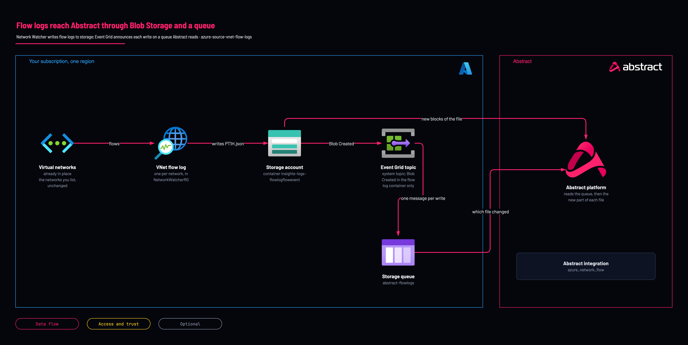

# Virtual network flow logs to Abstract

<!-- Generated from template.yml by `python -m tools.templates generate`. Do not edit. -->

<picture><source media="(prefers-color-scheme: dark)" srcset="https://raw.githubusercontent.com/IamABS3C/abstract-cloud-templates/main/docs/brand/abstract-logo-white.svg"></picture>

Flow logs never pass through an Event Hub: Network Watcher writes them to Blob Storage. This template builds the path the Azure Network Flow Log integration reads, for the virtual networks of one region: a storage account kept for flow logs with a queue, an Event Grid subscription that puts a message on the queue each time a flow log file is written, and one virtual network flow log per network. Abstract reads the queue, then only the new part of each file.

**Cloud:** azure · **Role:** source · **Scope:** resource-group



Editable source: [diagram.drawio](diagram.drawio)

## When to use

Network flow visibility (who talked to whom, allowed or denied) for virtual networks, read by the Azure Network Flow Log integration.

**Not for:** Activity Log, resource logs and Entra ID, which stream through the Event Hub foundation. Existing network security group flow logs can also be read by the same integration; this template creates virtual network flow logs, which Microsoft recommends.

Not sure this is the right one, or what to deploy before it? Answer a few questions in [the setup guide](https://github.com/IamABS3C/abstract-cloud-templates/blob/main/docs/azure/GUIDE.md).

## Deploy

[](https://portal.azure.com/#create/Microsoft.Template/uri/https%3A%2F%2Fraw.githubusercontent.com%2FIamABS3C%2Fabstract-cloud-templates%2Fmain%2Ftemplates%2Fazure%2Fazure-source-vnet-flow-logs%2Fazuredeploy.json)

Or from a shell, in this folder:

```bash
az group create -n RESOURCE_GROUP -l LOCATION   # skip if it exists
./deploy.sh RESOURCE_GROUP
./deploy.sh RESOURCE_GROUP --yes
```

`./deploy.sh RESOURCE_GROUP` previews the change with what-if and changes nothing; adding `--yes` deploys. Add `--parameters NAME=VALUE` after the scope to override a parameter.

## Prerequisites

- One deployment per region: every network in virtualNetworkIds, the storage account and the Network Watcher share a region
- The region's Network Watcher exists (Azure creates NetworkWatcher_&lt;region&gt; in NetworkWatcherRG when the first virtual network is created there)
- The Microsoft.Insights and Microsoft.EventGrid resource providers are registered on the subscription
- A network logs only when traffic flows; a network with no running workload writes no file and puts no message on the queue

## Cost

Network Watcher charges per GB of flow logs collected, and the storage account for what it keeps (retentionDays). Event Grid and the queue add a small charge per operation. Volume follows traffic, and busy networks write a lot.

## Parameters

| Name | Type | Required | Description | Find it |
|---|---|---|---|---|
| `location` | string | no | Region of the storage account, the Event Grid topic and the flow logs. Must be the region of every virtual network in virtualNetworkIds and of the Network Watcher. |  |
| `virtualNetworkIds` | array | yes | Resource IDs of the virtual networks to log, all in this region and this subscription. One flow log is created per network. | `az resource list --resource-type Microsoft.Network/virtualNetworks --query "[?location=='<region>'].id" -o tsv` |
| `storageAccountName` | string | no | Storage account to create for the flow logs and the queue. Empty generates absflow&lt;hash&gt;. 3-24 lowercase letters and digits, globally unique. |  |
| `queueName` | string | no | Queue the Event Grid subscription writes to. Enter it in the Queue Name field of the Abstract integration. |  |
| `systemTopicName` | string | no | Name of the Event Grid system topic on the storage account. |  |
| `networkWatcherName` | string | no | Network Watcher of this region. Azure creates NetworkWatcher_&lt;region&gt; in NetworkWatcherRG the first time a virtual network is created in a region. | `az network watcher list --query "[?location=='<region>'].{name:name,group:resourceGroup}" -o table` |
| `networkWatcherResourceGroup` | string | no | Resource group of the Network Watcher; the flow logs are created there. |  |
| `retentionDays` | int | no | Days Azure keeps flow log files in the storage account (0 keeps them forever). Abstract reads each record within minutes of the write, so this is your own retention, not Abstract's. |  |
| `tags` | object | no | Tags applied to the storage account and the Event Grid topic. |  |

## Permissions

- **Contributor** on The target resource group: Deployer: Create the storage account, queue, Event Grid system topic and subscription.
- **Network Contributor** on The Network Watcher's resource group (NetworkWatcherRG) and the virtual networks: Deployer: Create a flow log on each virtual network in the region's Network Watcher.
- **Microsoft.Insights resource provider registered** on The subscription: Network Watcher: Flow logs need it; register it once with az provider register --namespace Microsoft.Insights.
- **The storage account's connection string (shared key)** on The flow log storage account: Abstract: Reads the queue and the flow log blobs; the Azure Network Flow Log integration signs in with the connection string.

## Creates

- A StorageV2 account kept for flow logs (TLS 1.2, no public blob access), default name absflow&lt;hash&gt;
- A storage queue abstract-flowlogs
- An Event Grid system topic on the account, and a subscription that sends Blob Created events in the flow log container to the queue (Event Grid schema)
- One virtual network flow log (format version 2) per network in virtualNetworkIds, in the region's Network Watcher; Network Watcher creates the container insights-logs-flowlogflowevent on the first write

## Never touches

- The virtual networks, their subnets, network security groups and traffic
- Existing flow logs, including network security group flow logs
- Traffic analytics and Log Analytics workspaces
- Any other storage account

## Outputs

- `storageAccountName`
- `containerName`
- `queueName`
- `flowLogIds`
- `abstractOnboarding`

## Verify

| Check | Command | Healthy when |
|---|---|---|
| A flow log exists and is enabled for each network | `az network watcher flow-log list --location <region> --query "[].{name:name,enabled:enabled,target:targetResourceId}" -o table` | One abstract-&lt;network&gt; flow log per network, enabled. |
| Flow log files are being written (--auth-mode key reads the account key, which Contributor can; --auth-mode login needs a Storage Blob or Queue Data role, which Owner alone does not give) | `az storage blob list --account-name <storageAccountName> --container-name insights-logs-flowlogflowevent --auth-mode key --query "length(@)"` | A count above zero once traffic has flowed; the container appears on the first write. |
| The queue receives a message for each write | `az storage message peek --queue-name abstract-flowlogs --account-name <storageAccountName> --auth-mode key --num-messages 1` | A base64 message whose JSON has eventType Microsoft.Storage.BlobCreated and a data.url in the flow log container. After Abstract is reading, the queue stays near empty. |
