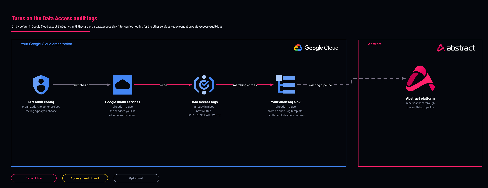

# Turn on Data Access audit logs: organization, folder or project

<!-- Generated from template.yml by `python -m tools.templates generate`. Do not edit. -->

Admin Activity audit logs are always on; Data Access logs are off by default for every service except BigQuery, and until they are on a sink filter referencing data_access matches nothing for the others. This deployment enables the chosen Data Access log types in separate state from the log-export pipeline.

**Cloud:** gcp · **Role:** foundation · **Scope:** organization



Editable source: [diagram.drawio](diagram.drawio)

## When to use

Data Access signal (BigQuery reads, Cloud Storage object reads, KMS use) is needed, decided per service.

**Not for:** To change Admin Activity logs, which are always on; or before reading the current audit config, because this resource is authoritative per service.

Not sure this is the right one, or what to deploy before it? Answer a few questions in [the setup guide](https://github.com/IamABS3C/abstract-cloud-templates/blob/main/docs/gcp/GUIDE.md).

## Deploy

[](https://shell.cloud.google.com/cloudshell/editor?cloudshell_git_repo=https://github.com/IamABS3C/abstract-cloud-templates&cloudshell_git_branch=main&cloudshell_workspace=templates/gcp/gcp-foundation-data-access-audit-logs&cloudshell_tutorial=TUTORIAL.md)

Or from a shell, in this folder:

```bash
./deploy.sh
```

In Cloud Shell, create `backend.tf` first (TUTORIAL.md, the Terraform section, step 1): the session's files, Terraform state included, are deleted when it ends, so `./deploy.sh` stops there without it.

## Prerequisites

- Read the preflight output first. The template applies ONE log_types list and ONE exempted_members list to every service it names, replacing what each one has today: name only services whose existing settings you accept being replaced by those, and leave out any service that already has DATA_READ or exempted members, or manage it only from a separate root with its own backend prefix, after removing it from this root's services
- acknowledge_authoritative_overwrite = true on every apply, after reading the preflight output, and acknowledge_data_read for DATA_READ on allServices

## Cost

BigQuery DATA_READ on a BigQuery-heavy estate can move total volume by one to two orders of magnitude; scope it to BigQuery and regulated buckets rather than refusing it.

## Parameters

| Name | Type | Required | Description | Find it |
|---|---|---|---|---|
| `scope` | string | no | organization \| folder \| project. Inheritance is ONE-WAY — a project can add Data Access logging but cannot disable what the organization enabled. |  |
| `org_id` | string | no | Organization ID, when scope = organization. Find it with: gcloud organizations list | `gcloud organizations list --format='value(ID)'` |
| `folder_id` | string | no | Folder ID, when scope = folder. Find it with: gcloud resource-manager folders list --organization=&lt;org-id&gt; | `gcloud resource-manager folders list --organization=<org-id>` |
| `project_id` | string | no | Project ID, when scope = project. |  |
| `log_types` | array | no | ADMIN_READ \| DATA_WRITE \| DATA_READ. ADMIN_WRITE is rejected — that is Admin Activity, always on. |  |
| `services` | array | no | Services to turn Data Access logs on for. Name them; the guided setup's five are the example. Empty means allServices, which is authoritative for every service at this scope and, with DATA_READ, the expensive option that needs acknowledge_data_read. Service account token minting and impersonation is recorded only through iam.googleapis.com (ADMIN_READ); iamcredentials.googleapis.com is refused at plan, because it does nothing. Add sts.googleapis.com for Workload Identity Federation. The template applies ONE log_types list and ONE exempted_members list to every service it names, so leave out any service that already has DATA_READ or exempted members, or manage it only from a separate root with its own backend prefix, after removing it from this root's services. |  |
| `exempted_members` | array | no | Principals excluded. One chatty ETL service account can dominate DATA_READ volume while carrying no security signal — this is the most-missed cost lever. |  |
| `acknowledge_data_read` | bool | no | Required for DATA_READ when services is empty (allServices). |  |
| `acknowledge_authoritative_overwrite` | bool | no | Required on every apply. The audit config is authoritative for every service it names, not only allServices - applying REPLACES the log types and exempted members already set on those services, and destroy REMOVES them. Read tools/gcp-guided-setup/preflight.sh output first. To offboard without changing logging, run terraform state rm 'module.audit_config'. |  |

## Permissions

- **roles/resourcemanager.organizationAdmin or roles/iam.securityAdmin (resourcemanager.organizations.setIamPolicy)** on The organization, when scope = organization: Deployer: This modifies the organization IAM policy's audit configuration.
- **roles/resourcemanager.folderAdmin or roles/iam.securityAdmin (resourcemanager.folders.setIamPolicy)** on The folder, when scope = folder: Deployer: This modifies the folder IAM policy's audit configuration.
- **roles/resourcemanager.projectIamAdmin or roles/iam.securityAdmin (resourcemanager.projects.setIamPolicy)** on The project, when scope = project: Deployer: This modifies the project IAM policy's audit configuration.

## Creates

- An IAM audit config at the chosen scope (organization, folder or project) enabling the listed Data Access log types

## Never touches

- Admin Activity audit logs: always on, and nothing here can turn them off
- The log-export pipeline: this is deliberately separate state

## Outputs

- `enabled`

## Verify

| Check | Command | Healthy when |
|---|---|---|
| See what is already enabled | `tools/gcp-guided-setup/preflight.sh --project <project-id> --org-id <org-id>` | The audit config lists exactly the services and log types you chose. |

## Google documentation

Google's own pages on what this template sets up, and the Terraform provider's pages for the resources it creates:

- [Cloud Audit Logs overview](https://docs.cloud.google.com/logging/docs/audit#types)
- [Enable Data Access audit logs](https://docs.cloud.google.com/logging/docs/audit/configure-data-access#auditconfig_objects)
- [Identity and Access Management audit logging](https://docs.cloud.google.com/iam/docs/audit-logging)
- [Service Account Credentials audit logging](https://docs.cloud.google.com/iam/docs/audit-logging/audit-logging-iamcreds)
- [Security Token Service audit logging](https://docs.cloud.google.com/iam/docs/audit-logging/audit-logging-sts)
- [google_organization_iam](https://registry.terraform.io/providers/hashicorp/google/latest/docs/resources/google_organization_iam)
