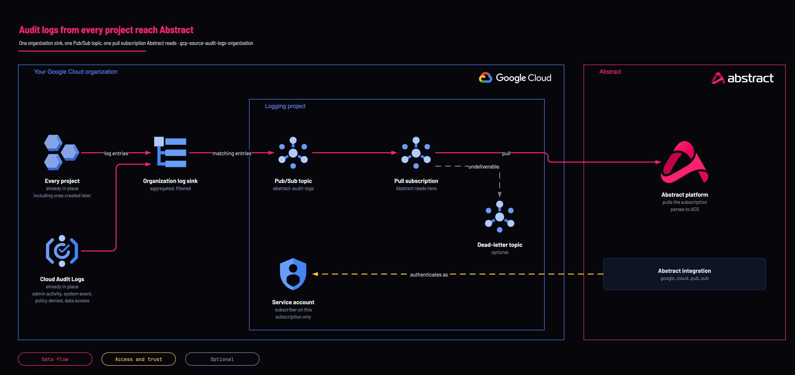

# All Google Cloud audit logs to Abstract: organization sink

<!-- Generated from template.yml by `python -m tools.templates generate`. Do not edit. -->

One aggregated Cloud Logging sink at organization scope routes audit and platform logs from every project into one Pub/Sub topic for Abstract. Projects created later are covered automatically, because the sink's scope is containment rather than a list.

**Cloud:** gcp · **Role:** source · **Scope:** organization



Editable source: [diagram.drawio](diagram.drawio)

## When to use

Every GCP engagement, from a single project up to a multi-folder organization.

**Not for:** Logs already sitting as objects in a bucket, Google Workspace sign-ins, and Security Command Center findings, which each have their own path.

Not sure this is the right one, or what to deploy before it? Answer a few questions in [the setup guide](https://github.com/IamABS3C/abstract-cloud-templates/blob/main/docs/gcp/GUIDE.md).

## Deploy

[](https://shell.cloud.google.com/cloudshell/editor?cloudshell_git_repo=https://github.com/IamABS3C/abstract-cloud-templates&cloudshell_git_branch=main&cloudshell_workspace=templates/gcp/gcp-source-audit-logs-organization&cloudshell_tutorial=TUTORIAL.md)

Or from a shell, in this folder:

```bash
./deploy.sh
```

In Cloud Shell, create `backend.tf` first (TUTORIAL.md, the Terraform section, step 1): the session's files, Terraform state included, are deleted when it ends, so `./deploy.sh` stops there without it.

## Prerequisites

- A dedicated logging or security project, not a workload project
- The organization ID
- Data Access audit logs are off by default for every service except BigQuery, which writes its Data Access logs by default; for the others a filter referencing data_access matches nothing until they are enabled
- The org policy constraints/iam.disableServiceAccountKeyCreation, or its managed successor constraints/iam.managed.disableServiceAccountKeyCreation, blocks the key Abstract authenticates with
- Deployed from an earlier version of this template? Apply it again. The default log_categories now routes only Cloud Audit Logs: firewall and DNS logs are dropped from the filter unless your terraform.tfvars lists them, and Abstract's managed GCP parser discards them anyway (collect them with gcp-source-network-threat-logs). The apply also adds the managed-by marker to the sink's description, which tells the guided setup to advise a tfvars change instead of editing the sink.

## Cost

Pub/Sub throughput is usually the largest line. BigQuery Data Access reads are both the richest exfiltration signal and the biggest cost driver, able to move volume by one to two orders of magnitude.

## Parameters

| Name | Type | Required | Description | Find it |
|---|---|---|---|---|
| `org_id` | string | yes | Organization ID. Find it with: gcloud organizations list | `gcloud organizations list --format='value(ID)'` |
| `log_project` | string | yes | DEDICATED logging or security project holding the topic and subscription. Not a workload project — Pub/Sub publish quota is consumed here, and a workload owner should not be able to read or break the security pipeline. Find it with: gcloud projects list. If no dedicated logging project exists yet, create one first with templates/gcp/gcp-foundation-logging-project (set create_project = true) — do not point this at a workload project. | `gcloud projects list --format='value(projectId)'` |
| `log_categories` | array | no | Named sources to route, from the catalog in templates/gcp/_modules/log-export/log_catalog.tf. The default is the three Cloud Audit Logs that Abstract's managed GCP Pub/Sub parser stores (Admin Activity, System Event, Policy Denied); that parser drops every record that is not a Cloud Audit Log, so firewall, DNS, NAT, load-balancer and Cloud SQL logs routed here are pulled and discarded. Use gcp-source-network-threat-logs for those. To record service account token minting (iamcredentials.googleapis.com) and Workload Identity Federation (sts.googleapis.com), add identity_access and apply this before turning their Data Access logs on with gcp-foundation-data-access-audit-logs. It is low volume and needs no acknowledgement. |  |
| `data_access_services` | array | no | Read only when data_access_all is in log_categories; on its own this list routes nothing, identity services included (for those, add identity_access to log_categories instead). With data_access_all, it restricts Data Access logs to these services rather than the whole estate; empty means every service, the expensive option. Use the serviceName the events carry - for service account token minting that is iamcredentials.googleapis.com, even though gcp-foundation-data-access-audit-logs turns it on as iam.googleapis.com - and sts.googleapis.com for Workload Identity Federation. |  |
| `exclusions` | array | no | Sink exclusion filters for known noise (health checks, chatty service accounts). Exclusions cost nothing to evaluate while ingestion and Pub/Sub throughput are billed, so this is the cheapest cost lever. Max 50 per sink. |  |
| `acknowledge_high_volume` | bool | no | Required to select an extreme-tier category (vpc_flows, gke_container_logs), and for data_access_all only when data_access_services is empty. These can dominate the bill; measure a 7-day baseline first. |  |
| `labels` | object | no | Labels applied to every resource this template creates. |  |
| `retention_days` | int | no | Pub/Sub message retention, 1-31. THIS IS YOUR ENTIRE RECOVERY WINDOW: when the oldest unacked message reaches it, the data is deleted permanently with no error and no backfill. 7 gives you a long weekend. |  |
| `ack_deadline_seconds` | int | no | Pub/Sub ack deadline for Abstract's subscription, in seconds. |  |
| `enable_dead_letter` | bool | no | Send repeatedly-failing messages to a dead-letter topic instead of retrying forever. Pair it with gcp-monitoring-pipeline-health-alerts — a dead-letter topic nobody watches converts a loud failure into a silent one. |  |
| `dead_letter_max_delivery_attempts` | int | no | Deliveries attempted before a message is dead-lettered (Pub/Sub allows 5-100). Used only with enable_dead_letter. |  |
| `topic_name` | string | no | Renaming this FORCE-REPLACES the topic and cascades to the subscription, discarding every un-acked message. prevent_destroy blocks it; that is intentional. |  |
| `subscription_name` | string | no | Pull subscription Abstract reads. Renaming it replaces the subscription. |  |
| `sink_name` | string | no | Name of the Cloud Logging sink. |  |
| `service_account_id` | string | no | Account ID of the service account Abstract authenticates as (roles/pubsub.subscriber on the subscription only). |  |
| `custom_filter` | string | no | Replace the assembled filter entirely. Bypasses every guard in the catalog -- you own the volume. |  |
| `platform_log_filters` | array | no | Extra raw logName clauses the catalog does not cover, e.g. cloudaudit.googleapis.com%2Faccess_transparency |  |

## Permissions

- **roles/logging.configWriter** on The organization: Deployer: Create the aggregated sink; the blocking prerequisite, rarely held by whoever owns the project.
- **roles/pubsub.admin** on The logging project: Deployer: Create the topic, subscription and IAM bindings.
- **roles/iam.serviceAccountAdmin** on The logging project: Deployer: Create Abstract's service account.
- **roles/serviceusage.serviceUsageAdmin** on The logging project: Deployer: Enable APIs.
- **roles/pubsub.publisher** on The topic: Sink writer identity: Created with the sink and holding nothing until granted; this module grants it.
- **roles/pubsub.subscriber** on The subscription only: Abstract service account: Abstract pulls; not publisher, not project-wide.

## Creates

- A Pub/Sub topic (default abstract-audit-logs) and a never-expiring pull subscription (default abstract-audit-logs-sub, 7-day retention)
- The roles/pubsub.publisher binding for the sink's writer identity
- A service account (default abstract-pubsub-reader) with roles/pubsub.subscriber on the subscription only
- Optional dead-letter topic (enable_dead_letter, off by default)
- An aggregated organization sink (default abstract-org-audit-sink) with include_children

## Never touches

- Existing sinks, including _Default and _Required
- Data Access audit configuration (gcp-foundation-data-access-audit-logs owns that)
- IAM in workload projects: every grant is on the topic or the subscription

## Outputs

- `abstract_onboarding`
- `effective_filter`
- `selected_log_sources`
- `sink_writer_identity`
- `volume_profile`

## Verify

These read, and change nothing. They use LOG_PROJECT and ORG_ID from the guided setup's answers: run `source ~/.abstract-gcp-setup.env` first, or `export` each one. An UPPERCASE word such as YOUR_BUCKET or BILLING_ACCOUNT_ID is yours to replace.

| Check | Command | Healthy when |
|---|---|---|
| The sink exists and is aggregated | `gcloud logging sinks describe abstract-org-audit-sink --organization="$ORG_ID" --format="value(name,includeChildren,destination)"` | includeChildren is True and the destination is the Abstract topic. |
| The writer identity holds publisher on the topic | `gcloud pubsub topics get-iam-policy abstract-audit-logs --project="$LOG_PROJECT"` | The sink's writer identity has roles/pubsub.publisher. |
| A fresh event reaches the topic from the sink | `./tools/gcp-guided-setup/abstract-gcp-setup.sh --step 9` | A ✓ "the test event arrived" within five minutes, from the top folder of the repository. It writes a fresh event in your scope and waits on a probe subscription of its own, which it deletes; it never reads Abstract's subscription. Wait five minutes after creating the sink before testing. |
| No sink errors | `gcloud logging read 'logName:"logging.googleapis.com%2Fsink_error"' --limit=20 --project="$LOG_PROJECT"` | No sink_error entries. |

## Google documentation

Google's own pages on what this template sets up, and the Terraform provider's pages for the resources it creates:

- [Cloud Audit Logs overview](https://docs.cloud.google.com/logging/docs/audit#types)
- [Collate and route organization- and folder-level logs to supported destinations](https://docs.cloud.google.com/logging/docs/export/aggregated_sinks#aggregated-sinks)
- [Route logs to supported destinations](https://docs.cloud.google.com/logging/docs/export/configure_export_v2#dest-auth)
- [Logging query language](https://docs.cloud.google.com/logging/docs/view/logging-query-language)
- [Subscription properties](https://docs.cloud.google.com/pubsub/docs/subscription-properties)
- [logging_organization_sink](https://registry.terraform.io/providers/hashicorp/google/latest/docs/resources/logging_organization_sink)
- [pubsub_topic_iam](https://registry.terraform.io/providers/hashicorp/google/latest/docs/resources/pubsub_topic_iam)
- [google_service_account_key](https://registry.terraform.io/providers/hashicorp/google/latest/docs/resources/google_service_account_key)
